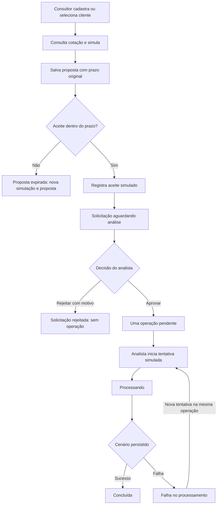

# ExchangeDesk V1.1 — relatório de implementação e funcionamento

Este documento consolida a base reaproveitada da V1, as funcionalidades implementadas na V1.1, a forma como foram construídas e os motivos das escolhas. O objetivo da versão é organizar o atendimento de câmbio, separar responsabilidades da equipe e acompanhar uma operação desde a cotação até o resultado do processamento simulado.

## 1. Resultado da versão

O fluxo comercial e operacional disponível é:



O gerente acompanha os registros e indicadores da equipe. O administrador gerencia acessos e consulta registros para suporte. O cliente não possui login nem registra aceite diretamente: o aceite desta versão é explicitamente simulado pelo consultor.

Não há execução de pagamento, liquidação ou transferência. A cotação é real e de referência diária; o processamento operacional é uma simulação controlada.

## 2. O que veio da V1 e o que mudou

| Área | Base mantida | Evolução da V1.1 |
| --- | --- | --- |
| Autenticação | E-mail/senha, Auth.js, Argon2id e sessão JWT | Quatro perfis, situação ativa e revogação de sessões |
| Clientes | Cadastro e consulta com validação | Cadastro exclusivo do consultor e leitura conforme o perfil |
| Cotações | Frankfurter / ECB, moedas BRL, USD e EUR | Referência preservada em proposta, aceite e operação |
| Simulações | Cálculo decimal, prazo e histórico por autor | Origem de propostas, com vínculo no histórico |
| Operações | Valores persistidos e auditoria | Criação somente após aprovação de solicitação |
| Etapas comerciais | Confirmação direta da simulação | Proposta, aceite simulado, solicitação e decisão separadas |
| Processamento | Transições do fluxo legado | Tentativas simuladas, falha, retomada e nova tentativa |
| Funcionários | Cadastro e listagem administrativos | Troca de perfil, desativação, reativação e histórico |
| Painéis | Contadores de operações e simulações próprias | Indicadores de propostas/solicitações, fila de análise e situação dos acessos |

O fluxo legado de operações foi preservado para registros anteriores, sem inventar propostas ou aceites retroativos.

## 3. Perfis e autorização

### O que foi implementado

Cada funcionário tem um único perfil em `User.role`:

| Perfil | Ações e consultas |
| --- | --- |
| Consultor de Câmbio (`CONSULTANT`) | Cadastra clientes, simula, cria suas propostas, registra aceite simulado e acompanha seus registros |
| Analista de Operações (`OPERATIONS_ANALYST`) | Consulta solicitações e operações da equipe, decide solicitações e conduz processamento simulado |
| Gerente (`MANAGER`) | Consulta propostas, solicitações, operações, clientes e indicadores da equipe |
| Administrador (`ADMIN`) | Cadastra funcionários, gerencia acessos e consulta registros da equipe para suporte |

As simulações individuais são exclusivas do consultor autor. Consultor, analista e gerente consultam todos os clientes; o administrador consulta o cadastro apenas de clientes vinculados a operações. Os detalhes de propostas e solicitações também exibem os dados públicos do cliente vinculado, conforme o acesso a esses registros.

Analistas não consultam propostas ainda sem aceite. Consultores veem apenas suas propostas, solicitações, operações e respectivas auditorias. Gerentes e administradores consultam a equipe, sem ações comerciais ou de decisão. O administrador não herda as funções dos outros perfis.

### Como foi feito e por quê

`src/domain/permissions.ts` centraliza permissões. As guardas em `src/server/auth` verificam sessão e consultam o funcionário atual no banco. Os serviços aplicam o alcance dos registros nas consultas e mutações; esconder um botão na interface não é a proteção de acesso.

A identidade do autor permanece no registro. O criador de uma solicitação não pode aprová-la nem rejeitá-la, mesmo depois de passar a analista. A mesma separação impede o processamento de uma operação de sua autoria comercial. O analista que aprovou pode processar, pois não substitui o consultor como autor comercial.

A mudança de perfil substitui a função, sem acumular permissões e sem reescrever a autoria anterior. Isso mantém responsabilidade e histórico verificáveis.

## 4. Login, senhas e sessões

O login usa Auth.js Credentials. Senhas são armazenadas como hash Argon2id e nunca são retornadas pelas APIs de funcionários. A sessão JWT dura até oito horas.

O servidor verifica o perfil atual, a situação ativa e a versão de sessão no banco. Trocar o perfil muda as permissões nas próximas requisições, incluindo sessões já abertas. Desativar uma conta impede novos logins e incrementa `sessionVersion`, invalidando os cookies existentes. Reativar permite novo login com a senha preservada, mas não torna válidas as sessões anteriores à desativação.

Essa versão evita que um token antigo continue concedendo um perfil removido ou volte a funcionar depois da reativação. A revogação vale para requisições seguintes; não cancela uma transação de negócio já iniciada. A própria gestão de acessos revalida o executor dentro da transação para proteger também mudanças que estavam aguardando bloqueio.

O primeiro administrador é criado pelo comando local `npm run admin:create`, sem cadastro público. O bootstrap é serializado e recusa criar outro administrador inicial se já existir um; não redefine senha nem modifica usuários existentes.

## 5. Clientes, cotação e cálculo

### Clientes

O consultor cadastra nome, CPF fictício, e-mail e telefone. Os schemas Zod normalizam e validam os campos; e-mail é normalizado, CPF tem 11 dígitos e é único, telefone possui DDD e 10 ou 11 dígitos. Não há consulta a bases de CPF, validação documental ou envio de e-mail.

O cadastro compartilhado evita duplicar o cliente a cada atendimento. A autoria comercial fica na proposta e na operação, e não limita o cadastro compartilhado de clientes.

### Cotação e simulação

O adaptador consulta Frankfurter / ECB para BRL, USD e EUR, sempre com moedas de origem e destino diferentes. Valida a resposta, o par e a referência diária. Tem timeout de cinco segundos e cache em memória por 15 minutos por par. Falha do provedor retorna indisponibilidade, sem substituir a cotação por dado fictício.

São preservados fonte, data diária de referência, instante da consulta, taxa, moedas e valores. O instante da consulta não é apresentado como horário de mercado. O cache preserva a consulta original; ele é independente do prazo de aceite de cada simulação.

O cálculo utiliza aritmética decimal, taxa com oito casas e valores com duas casas. O arredondamento é de metade para cima. Por exemplo, uma origem de USD 100,00 e taxa 5,12345678 resulta em BRL 512,35. A taxa normalizada e o resultado são os mesmos preservados nas etapas seguintes.

Isso evita divergências de centavos e impede que o navegador decida a taxa ou altere o resultado. Não são calculados IOF, spread, tarifas ou impostos.

## 6. Simulação assinada e histórico

Cada simulação bem-sucedida salva um registro com autor, valores e referência antes de devolver o token confirmável. Se o histórico não puder ser salvo, o sistema não entrega uma nova simulação utilizável.

A referência é assinada com HMAC derivado de `AUTH_SECRET` e vinculada ao funcionário. O verificador confere assinatura, autoria, prazo e coerência do cálculo. A chave interna de uso único é derivada do conteúdo por SHA-256. Assinatura garante integridade, não criptografa o conteúdo.

O prazo é de 15 minutos desde a emissão da simulação. Salvar ou consultar histórico não renova esse prazo. O histórico mostra até 50 simulações próprias recentes, com atalhos para proposta/operação vinculada e para simular novamente. Simular novamente preenche os campos e exige outra consulta; não reutiliza um aceite vencido.

A referência assinada protege valores contra adulteração. O vínculo persistido e as restrições únicas no banco impedem reutilização ou duplicação do mesmo atendimento por reenvio.

## 7. Propostas e aceite simulado

O consultor seleciona um cliente e salva a proposta a partir de uma simulação válida e de sua autoria. O servidor obtém os valores da referência verificada; não recebe valor ou taxa como campo livre para criar a proposta.

A proposta preserva cliente, consultor, moedas, valores, taxa, fonte, datas e prazo original. Uma mesma simulação não gera propostas para clientes diferentes nem pode reutilizar uma operação legada já confirmada.

Os estados apresentados são derivados:

| Estado | Funcionamento |
| --- | --- |
| Aguardando aceite | Ainda não aceita e prazo não encerrado |
| Expirada | Ainda não aceita e prazo encerrado; exige nova simulação/proposta |
| Aceita | Aceite válido registrado; valores preservados para análise posterior |

A expiração é conferida no servidor. Não depende de tarefa agendada e não muda uma proposta já aceita para expirada.

O aceite é uma segunda ação, com confirmação explícita de que é simulado. Ele grava `acceptedAt`, cria uma única solicitação `PENDING_REVIEW` e registra o evento de aceite na mesma transação. Reenvio retorna a solicitação existente, inclusive após o prazo original. Não cria operação.

A separação entre salvar, aceitar e aprovar torna o efeito de cada etapa explícito e impede tratar uma simulação como operação autorizada.

## 8. Solicitações e decisão do analista

A solicitação começa como `PENDING_REVIEW`. O analista confere cliente, consultor, valores e referência preservada e decide:

- `APPROVED`: cria uma única operação `PENDING`, vinculada à solicitação.
- `REJECTED`: exige motivo de 1 a 1000 caracteres após remoção de espaços nas extremidades e encerra a solicitação sem operação.

A decisão é definitiva. Não há edição posterior do motivo, troca de decisão ou reabertura. Novo atendimento após rejeição usa outra proposta. O prazo de aceite não é reavaliado na decisão, porque o aceite válido já preservou os valores.

A aprovação mantém o consultor como autor comercial e registra o analista como responsável pela decisão e pela criação no histórico. Solicitação, operação, vínculo e eventos são gravados atomicamente. Uma falha de auditoria desfaz tudo.

Reenvios da mesma decisão e do mesmo motivo normalizado retornam o resultado original. Decisão diferente retorna conflito. Atualizações condicionais no estado pendente e restrições únicas resolvem decisões concorrentes sem duplicar operações ou eventos.

A criação direta por `POST /api/operacoes` está bloqueada: o consultor recebe `APPROVAL_REQUIRED`; os demais perfis não possuem a ação. Isso fecha o caminho que permitiria contornar a análise.

## 9. Processamento simulado e recuperação

Operações aprovadas usam `PENDING → PROCESSING → COMPLETED | FAILED`. Somente após `FAILED` é possível iniciar outra tentativa, na mesma operação. Uma operação `COMPLETED` não é reaberta.

Ao iniciar, o analista escolhe sucesso ou falha como cenário explícito da simulação. O cenário fica persistido e não pode ser modificado naquela tentativa. Não há resultado aleatório nem chamada de execução financeira externa.

Cada tentativa registra número, cenário, iniciador, início, instante mínimo para resultado, conclusão e motivo de falha. Após dois segundos, o servidor permite registrar o resultado conforme o cenário salvo. A tela do analista consulta o resultado automaticamente e oferece retomada manual.

Se navegador, rede ou processo forem interrompidos, a tentativa permanece no banco em `PROCESSING`. Um analista pode voltar à operação e retomar a mesma tentativa; outro analista também pode fazê-lo. Leituras GET não mudam estados. Não há worker ou processamento autônomo com a tela fechada.

Uma falha simulada gera `FAILED` e motivo legível. A próxima tentativa preserva a falha anterior e os mesmos valores aprovados. Falha técnica de gravação desfaz a transação; não inventa um resultado simulado e permite reenvio seguro.

`expectedAttemptCount` protege o início contra comandos antigos. O resultado exige o ID da tentativa atual e usa o cenário persistido. Reenvios são idempotentes e comandos de tentativas anteriores entram em conflito. Início e resultado gravam suas alterações e auditoria em transações separadas e atômicas, permitindo recuperação entre as etapas.

## 10. Gestão de acessos

O administrador consulta funcionários e altera um único perfil e a situação ativa. Os detalhes mostram resumo antes/depois, confirmação explícita e histórico com administrador executor, data e revisão.

Não é permitido alterar o próprio acesso. Para mudar um administrador, outro administrador deve atuar. O sistema preserva pelo menos um administrador ativo. Mudanças são serializadas por bloqueio transacional no PostgreSQL e o executor é revalidado após obter o bloqueio. Assim, dois administradores não conseguem desativar ou demover um ao outro simultaneamente e deixar a equipe sem administração ativa.

`expectedRevision` detecta alterações concorrentes. Reenvio da mesma mudança imediatamente anterior não cria evento, não substitui o responsável e não revoga sessões novamente. Uma revisão desatualizada divergente retorna conflito.

Perfil, situação, revisão, revogação e evento de histórico são atômicos. Falha do histórico mantém o acesso anterior. IDs, senhas, autoria e vínculos permanecem intactos. Não há exclusão de conta nem edição de nome/e-mail/senha nesta tela. Reativação não equivale a recuperação de senha.

A listagem usa tabela em desktop e cartões em celular. Isso mantém situação e link de gerenciamento acessíveis sem exigir rolagem horizontal da página.

## 11. Painéis por perfil

A tela `/inicio` acompanha o fluxo completo com números de registros, sem somar valores de moedas diferentes:

| Perfil | Indicadores e atalhos |
| --- | --- |
| Consultor | Propostas próprias válidas/expiradas/aceitas; solicitações próprias por decisão; operações próprias; simulações próprias e atalhos comerciais |
| Analista | Solicitações e operações da equipe; fila pendente, sem indicadores de propostas ainda sem aceite |
| Gerente | Propostas, solicitações, operações e fila da equipe para supervisão |
| Administrador | Consulta de atendimento/operações para suporte e contadores de funcionários ativos/desativados, com acesso à gestão |

A fila mostra até cinco solicitações pendentes, das mais antigas para as mais recentes, com acesso aos detalhes. Os contadores incluem todos os registros do escopo e não ficam limitados aos cinco itens. Quando um analista encontra solicitação de sua própria autoria, a fila sinaliza que a decisão está bloqueada.

Propostas aceitas continuam contadas como aceitas depois do prazo original. A operação distingue pendência, análise legada, processamento, falha, conclusão e cancelamento legado. O painel também mantém cinco operações recentes e, somente para o consultor, cinco simulações recentes.

O serviço de resumo usa contagens e agrupamentos no banco, sem carregar históricos inteiros. Os indicadores de propostas, solicitações, operações e acessos são lidos em uma transação `RepeatableRead`, evitando misturar estados de contagens durante aquela leitura. As listas recentes e o histórico de simulações são consultas autorizadas separadas. A página não consulta simulações individuais para perfis que não têm essa permissão.

Foram mantidos contadores reais em vez de gráficos ou metas artificiais para dar uma visão verificável e útil do trabalho pendente.

## 12. Arquitetura e integridade

O projeto mantém interface e servidor no mesmo Next.js Full Stack com TypeScript:

```text
Páginas de servidor → serviços autorizados → Prisma → PostgreSQL
Formulários de cliente → API/Server Actions → sessão + permissão + Zod → serviços
Serviço de simulação → adaptador Frankfurter / ECB
```

- `src/app`: páginas, layouts, rotas HTTP e ações de autenticação.
- `src/components`: formulários, navegação, resumos e apresentação dos registros.
- `src/domain`: permissões, transições legadas e cálculo decimal.
- `src/schemas`: validação estrita das entradas.
- `src/server/auth`: credenciais, sessão, autorização e bootstrap.
- `src/server/services`: regras de negócio e transações.
- `src/server/quotes`: consulta de cotação e referência assinada.
- `prisma`: modelo e migrações incrementais.
- `tests`: verificações unitárias, banco real e HTTP real.

Módulos de servidor usam `server-only`. As rotas delegam as regras aos serviços, que também verificam acesso. As mutações JSON verificam origem informada e o tipo de conteúdo; entradas extras são recusadas pelos schemas estritos. As respostas operacionais usam `Cache-Control: no-store`. Segredos, tokens e chaves internas não são incluídos nas consultas públicas de registros.

As garantias combinam validação, autorização por ação/registro, transações, atualizações condicionais, chaves únicas e relações com restrição de exclusão. Não dependem apenas de desabilitar botões no navegador.

## 13. Modelo de dados e migrações

| Entidade | Responsabilidade |
| --- | --- |
| `User` | Funcionário, perfil único, hash, situação, versão de sessão e revisão de acesso |
| `Customer` | Cliente compartilhado, sem autenticação |
| `Simulation` | Histórico do consultor e vínculo da referência |
| `Proposal` | Valores e prazo preservados, cliente, autor e aceite |
| `ExchangeRequest` | Solicitação única por proposta, decisão e vínculo exclusivo à operação |
| `ExchangeOperation` | Operação, valores aprovados, estado e contador de tentativas |
| `ProposalAuditEvent` | Criação, aceite e decisão da solicitação |
| `OperationAuditEvent` | Criação e mudanças de estado da operação |
| `OperationProcessingAttempt` | Cenário, tempos e resultado de cada tentativa |
| `EmployeeAccessEvent` | Alterações de perfil/situação com executor e revisão |

As oito migrações existentes são:

| Migração | Entrega |
| --- | --- |
| `20261020190000_init` | Estrutura inicial e auditoria operacional |
| `20261031183000_operator_workspace` | Histórico de simulações por funcionário |
| `20261031200000_operation_confirmation` | Confirmação única das operações da V1 |
| `20261031210000_v1_1_roles` | Quatro perfis e preservação das contas atribuídas |
| `20261031220000_proposals_and_requests` | Propostas, solicitações, histórico e restrições de validade |
| `20261031230000_request_decisions` | Decisão, responsável, motivo e operação vinculada |
| `20261101000000_operation_processing` | Estados e tentativas de processamento simulado |
| `20261101010000_employee_access` | Situação e revisão de acesso, versão de sessão e histórico |

A revisão final dos painéis não exige nova migração. Migrações já aplicadas não foram renomeadas ou reescritas. A evolução foi aditiva, preservando IDs, valores, vínculos e históricos. Bancos de outros ambientes com contas `OPERATOR` exigem atribuição explícita antes de migrar; a migração de perfis recusa esses casos sem mapeamento.

Operações legadas continuam em `PENDING → UNDER_REVIEW → COMPLETED | CANCELED`. Os endpoints antigos não processam operações aprovadas da V1.1, e os novos endpoints exigem solicitação aprovada. Essa separação impede atribuir significado novo a estados antigos sem uma regra de migração.

## 14. Principais telas e entradas HTTP

| Tela | Funcionamento |
| --- | --- |
| `/login` | Entrada da equipe |
| `/inicio` | Painel conforme o perfil |
| `/clientes` e `/clientes/novo` | Consulta e cadastro permitido |
| `/simulacoes` e `/simulacoes/historico` | Consulta, revisão, criação de proposta e histórico próprio |
| `/propostas` e `/propostas/:id` | Consulta, valores, prazo, aceite e histórico |
| `/solicitacoes` e `/solicitacoes/:id` | Acompanhamento, decisão e operação vinculada |
| `/operacoes` e `/operacoes/:id` | Valores, estado, tentativas e auditoria |
| `/funcionarios`, `/funcionarios/novo` e `/funcionarios/:id` | Cadastro, consulta e gestão de acessos |

Principais mutações: `POST /api/simulacoes`, `POST /api/propostas`, `POST /api/propostas/:id/aceite`, `POST /api/solicitacoes/:id/decisao`, `POST /api/operacoes/:id/processamento`, `POST /api/operacoes/:id/processamento/resultado` e `PATCH /api/funcionarios/:id`. Os corpos, respostas e códigos de conflito estão em [API.md](./API.md).

## 15. Exemplo de uso

1. O administrador cadastra contas separadas para consultor e analista.
2. O consultor cadastra um cliente fictício e simula USD 100,00 para BRL.
3. Confere taxa, referência e resultado e salva uma proposta para esse cliente.
4. Ainda dentro dos 15 minutos desde a simulação, confirma o aceite simulado.
5. O sistema gera uma solicitação; o analista a encontra na fila de análise.
6. O analista aprova; o sistema cria uma única operação com os valores aceitos.
7. O analista escolhe “Simular falha” e inicia a primeira tentativa.
8. O resultado registra a falha e mantém a operação, os valores e o histórico.
9. O analista inicia uma nova tentativa com “Simular sucesso”; a operação é concluída.
10. Consultor acompanha seus registros; gerente supervisiona a equipe; administrador consulta para suporte. Nenhuma etapa executa pagamento.

Se o funcionário deixar a equipe, o administrador o desativa. Seus registros permanecem consultáveis pelos perfis autorizados. Se for reativado, precisará entrar novamente.

## 16. Como executar e verificar localmente

A versão usa Node.js 22, npm, PostgreSQL via Compose e as dependências fixadas no projeto. Configure `.env` a partir de `.env.example`, com `DATABASE_URL`, `AUTH_SECRET` e `AUTH_URL`. O banco descartável de integração usa `TEST_DATABASE_URL` e deve ter nome terminado em `_test`.

Com dependências instaladas e variáveis configuradas:

```bash
npm run db:up
npm run db:generate
npm run db:deploy
npm run dev
```

Para criar o primeiro administrador, configure temporariamente `BOOTSTRAP_ADMIN_NAME`, `BOOTSTRAP_ADMIN_EMAIL` e `BOOTSTRAP_ADMIN_PASSWORD`, execute `npm run admin:create` e remova essas variáveis depois. Contas adicionais usam o cadastro autenticado.

Verificações disponíveis:

```bash
npm run lint
npm run typecheck
npm test
npm run db:validate
npm run db:test:deploy
npm run test:integration
```

`test:integration` executa o build antes dos testes e usa exclusivamente o banco descartável. Os testes de integração limpam dados desse banco para montar cenários isolados; não devem ser apontados para dados de uso. O build também pode ser executado com `npm run build`.

## 17. Limites atuais e continuidade

O fechamento da V1.1 é local. Não inclui publicação ou configuração de hospedagem. Permanecem fora desta versão:

- Pagamentos, transferências, liquidação, contas, saldos ou ordens financeiras.
- Compliance financeiro, validação documental e verificação de CPF em serviços externos.
- Tarifas, spread, IOF, impostos e comissões.
- Cliente autenticado, assinatura digital ou aceite remoto real.
- Recuperação/redefinição de senha e edição cadastral do funcionário.
- Worker de processamento com a tela fechada, envio de e-mails e notificações externas.
- Paginação geral, filtros avançados, exportações e gráficos de mercado.

Os contadores representam o estado atual dos registros no escopo do usuário. Não calculam faturamento, conversão histórica por período, saldos ou desempenho financeiro. O cache de cotação é por processo; não é um cache distribuído. A revisão final e suas evidências são registradas abaixo.


## 18. Evidências do fechamento

| Verificação | Resultado |
| --- | --- |
| ESLint | Passou, sem avisos aceitos |
| TypeScript | Passou |
| Schema Prisma | Válido |
| Build de produção | Passou |
| Testes unitários | 41 passaram, em 9 arquivos |
| Testes de integração | 45 passaram, em 6 arquivos, com PostgreSQL descartável |
| HTTP real | Login/cookies, quatro perfis, proposta, aceite, decisão, falha/recuperação, alteração de acesso e sessão revogada verificados |
| Migrações locais | Oito migrações; aplicação e testes sem pendências |
| Visual | Quatro painéis em desktop e celular; larguras de 320 e 390 pixels sem rolagem horizontal da página |
| Limpeza | Contas/registros fictícios finais removidos; servidor temporário encerrado |

Os testes de integração abrangem integridade dos valores, expiração, autorização, identidade do autor após mudança de perfil, reenvios e disputas concorrentes. Incluem falhas reais de auditoria provocadas por triggers no banco descartável para verificar rollback de proposta, aceite, decisão, processamento e alteração de acesso. Também cobrem retomada por outro analista e preservação das operações legadas.

A revisão final acrescentou verificações dos contadores por autor/perfil, propostas expiradas sem alteração do prazo original, contas ativas/desativadas e fila limitada às cinco solicitações mais antigas, sem truncar os totais. A navegação por HTTP confirmou a apresentação correspondente aos quatro perfis.

A conferência visual final usou fixtures identificadas como fictícias, sem novas consultas ao provedor externo. O adaptador de cotação é coberto pelos testes automatizados com respostas controladas. A evolução não alterou o cadastro administrativo nem criou demonstrações no banco da aplicação. A última etapa não precisou de nova migração.

Permanece o aviso conhecido de depreciação do `pg` sobre consultas simultâneas no mesmo cliente, sem falhas nas verificações. Não foi realizada publicação, teste de carga ou configuração de ambiente de produção.

**Situação:** escopo local da V1.1 implementado e validação final concluída. As limitações da seção anterior continuam fora da entrega, e não são funcionalidades apresentadas como disponíveis.

## 19. Referências para manutenção

- [Plano e histórico de entregas](./V1_1_IMPLEMENTATION_PLAN.md).
- [Decisões e responsabilidades](./V1_1_DECISIONS.md).
- [Propostas, aceite e decisão](./V1_1_PROPOSAL_FLOW.md).
- [Processamento e recuperação](./V1_1_PROCESSING_FLOW.md).
- [Gestão de acessos](./V1_1_ACCESS_MANAGEMENT.md).
- [Contrato da API](./API.md).
- [Schema do banco](../prisma/schema.prisma).
- [Permissões de domínio](../src/domain/permissions.ts).
- [Resumo dos painéis](../src/server/services/dashboard.ts).
